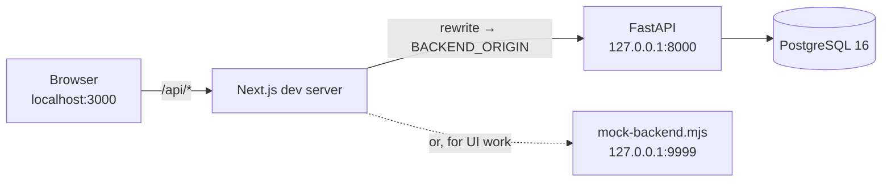

# SplitBill


Split group expenses in Thai baht. Record who paid, split the cost **equally** or by **exact
amounts**, and see who owes whom. Every amount is computed in integer satang, never floats, and
balances always sum to `0.00`.

> 🚧 **Status:** the frontend is complete and runs against a mock API. The backend has its
> setup, database connection and `/health` endpoint; the group, expense and balance endpoints
> are next. See [AI_NOTES.md](AI_NOTES.md) for the current state and the development plan.

---

## Repository layout

```
splitBill/
├── README.md        ← you are here
├── AI_NOTES.md      project map, known bugs, development plan
├── backend/         FastAPI + PostgreSQL 16 REST API      → backend/README.md
└── frontend/        Next.js 16 single-page client
```

| Part | Stack |
|---|---|
| Backend | Python 3.12, FastAPI, Pydantic v2, SQLAlchemy 2 (async) + psycopg 3, Alembic, uv, Ruff, pytest |
| Database | PostgreSQL 16 in Docker Compose |
| Frontend | Next.js 16, React 19, TypeScript, Tailwind CSS 4, Vitest |

## How it works



The browser only talks to the Next.js server. Next rewrites `/api/*` to the backend, so no CORS
setup is needed in development. The session cookie and the `Idempotency-Key` header pass through
as-is.

## Quick start

**Prerequisites:** Docker, [uv](https://docs.astral.sh/uv/), GNU make, Node.js 20+.

### Option A — frontend only, against the mock API

No database or Python needed. Handy for UI work.

```bash
cd frontend
npm install
npm run mock                                   # terminal 1: mock API on :9999
BACKEND_ORIGIN=http://127.0.0.1:9999 npm run dev   # terminal 2: app on :3000
```

Open http://localhost:3000 and sign in as `alice`, `bob`, `carol` or `dave` (password
`splitbill123`, mock only), or create an account.

### Option B — full stack

```bash
# 1. Backend
cd backend
cp .env.example .env        # then set POSTGRES_PASSWORD in .env
make db                     # start PostgreSQL
make migrate                # apply migrations
make dev                    # API on http://127.0.0.1:8000 (docs at /docs)

# 2. Frontend (new terminal)
cd frontend
npm install
npm run dev                 # http://localhost:3000 → proxies /api/* to :8000
```

Check the API with `curl http://127.0.0.1:8000/health`.

> Until the business endpoints land, the full stack only serves `/health`; use Option A to try
> the app.

## Using the app

1. **Sign in or create an account.** You only see the households you belong to. Switch between
   Thai and English at any time.
2. **Pick a group.**
3. **Add an expense:** description, amount, who paid, and the split:
   - **Equal** among the members you tick. Leftover satang go one at a time to members in list
     order: 1,000.00 among alice, bob and carol → 333.34 / 333.33 / 333.33.
   - **Exact** amounts per member. Submitting stays disabled until the shares add up to the total.
   A live preview shows each share as you type.
4. **Check balances.** Positive means the member is owed money; negative means they owe.
5. **Delete** an expense. Only the person who paid it can.

## API overview

All endpoints except `/health` and `/auth/*` need a signed-in session. The frontend and mock use
an HttpOnly session cookie ([AI_NOTES.md §4.1](AI_NOTES.md)); the backend currently specifies a
plain `X-User` header until that change is approved. Money is always a string with 2
decimals (`"1000.00"`). Errors are always `{"detail": "<message>"}`.

| Method | Path | Description |
|---|---|---|
| GET | `/health` | Liveness + database check |
| GET | `/groups` | Groups of the requesting user |
| GET | `/groups/{group_id}` | Group with its members |
| POST | `/groups/{group_id}/expenses` | Record an expense (needs `Idempotency-Key`) |
| GET | `/groups/{group_id}/expenses` | Expenses, newest first |
| DELETE | `/groups/{group_id}/expenses/{expense_id}` | Delete an expense (payer only) |
| GET | `/groups/{group_id}/balances` | Net balance per member |

Status codes: `401` not signed in · `404` unknown group or expense · `403` not a member / not the
payer · `400` business rule broken or `Idempotency-Key` missing · `409` key reused with a
different body · `422` malformed request.

Full contract and examples: [backend/README.md](backend/README.md) and
[backend/AI_NOTES.md](backend/AI_NOTES.md).

## Development

### Quality checks

```bash
# Backend
cd backend
uv run pytest
uv run ruff check . && uv run ruff format --check .   # or: make test / make lint

# Frontend
cd frontend
npx tsc --noEmit
npm run lint
npm test
```

### Useful backend commands

| Command | What it does |
|---|---|
| `make up` / `make down` | Start / stop the database and API containers |
| `make db` | Start only the database |
| `make dev` | Run the API locally with reload |
| `make migrate` | Apply migrations |
| `make revision m="..."` | Create a migration |
| `make logs` | Follow container logs |
| `make clean` | ⚠️ Stop everything **and delete the database volume** |

### Configuration

- **Backend:** environment variables from `backend/.env` (template: `backend/.env.example`).
  Database credentials are required; the app refuses to start without them. `.env` is never
  committed.
- **Frontend:** `BACKEND_ORIGIN` sets where `/api/*` is proxied (default `http://127.0.0.1:8000`).

### Ground rules

- Money is never a float: string in, integer satang inside, string out.
- Database changes only through Alembic migrations.
- No secrets in code or committed files.
- Backend layers import inward only (presentation → application → domain).
- Read [AI_NOTES.md](AI_NOTES.md) before contributing, and
  [backend/SECURITY_RULES.md](backend/SECURITY_RULES.md) for anything touching auth, secrets or
  dependencies.

## Roadmap

Short version. The full checklist is in [AI_NOTES.md §6](AI_NOTES.md).

1. Set up git and CI, fix the known frontend bugs
2. Backend domain core: money, splits, balances
3. Use cases with permission checks
4. Database tables, migrations and demo seed data
5. HTTP endpoints and API tests
6. Connect the frontend to the real backend
7. Frontend component tests and refactor
8. New features: settle-up suggestions, group management, real login
