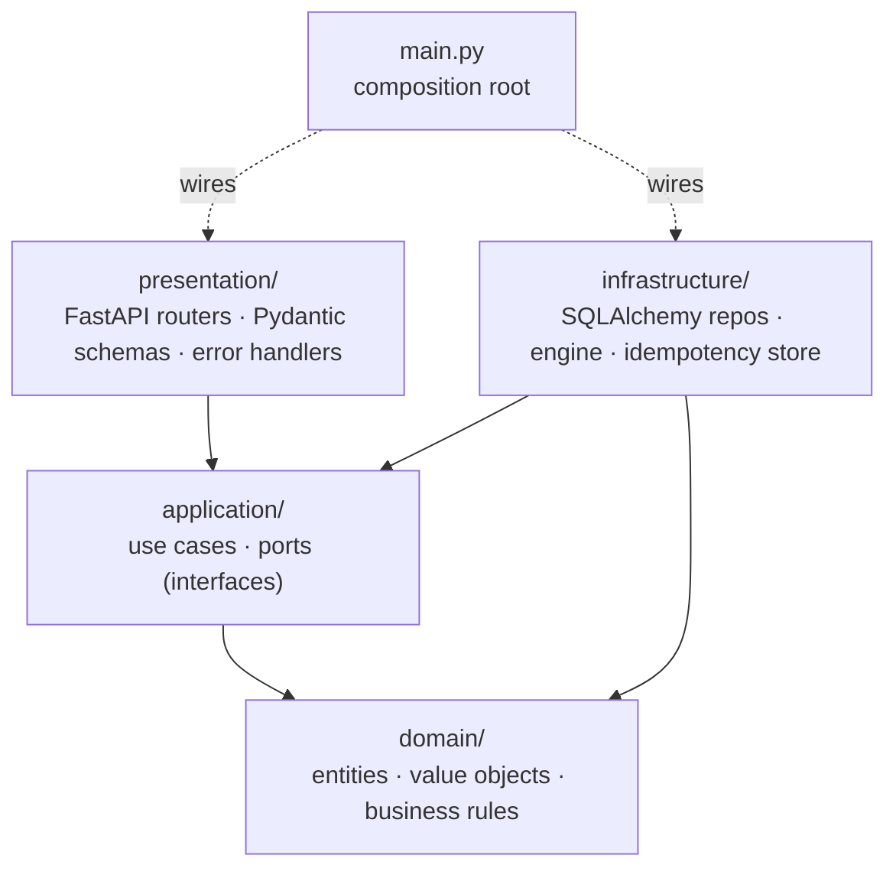

# SplitBill Backend

<div align="left">


</div>

REST API for splitting group expenses — groups, expenses with equal/exact splits, idempotent
writes, and per-member balances. Built with FastAPI on a clean architecture core, running on
PostgreSQL 16 in Docker.

> **Status:** every endpoint below is implemented, with account sign-in (session cookie),
> PostgreSQL persistence and 51 tests (unit, HTTP, and real-Postgres integration).

---

## Tech Stack

| Layer | Choice |
|---|---|
| Framework | FastAPI + Pydantic v2 |
| Database | PostgreSQL 16 (docker-compose) |
| Data access | SQLAlchemy 2 (async) + psycopg 3 |
| Migrations | Alembic |
| Package manager | [uv](https://docs.astral.sh/uv/) |
| Quality | Ruff (format + lint), pytest |

## Quick Start

**Prerequisites:** Docker, [uv](https://docs.astral.sh/uv/), GNU make.

```bash
# 1. Configure — credentials live ONLY here, never in code
cp .env.example .env
#    then edit .env and set POSTGRES_PASSWORD (required — the stack refuses to start without it)

# 2. Build & start Postgres 16 + API
make up

# 3. Apply database migrations
make migrate

# 4. (optional) Demo data — set SEED_DEMO_PASSWORD in .env first
make seed      # users alice, bob, carol, dave + three households

# 5. Verify
curl http://localhost:8000/health
# {"status":"ok","database":"up","env":"development"}
```

Interactive docs: **http://localhost:8000/docs** (Swagger UI)

## Make Commands

| Command | What it does |
|---|---|
| `make up` | Build (if needed) and start db + app |
| `make down` | Stop containers (keeps database data) |
| `make logs` | Follow logs of all services |
| `make ps` | Show container status |
| `make db` | Start only the database (for local dev server) |
| `make dev` | Run the API locally with uv + reload |
| `make migrate` | Apply pending Alembic migrations |
| `make revision m="add groups table"` | Generate a new migration |
| `make seed` | Add demo users, households and bills (idempotent) |
| `make db-shell` | psql shell inside the db container |
| `make app-shell` | Shell inside the app container |
| `make test` | Run the test suite |
| `make lint` | Ruff check + format check |
| `make clean` | ⚠️ Stop everything **and wipe the database volume** |

## API Overview

### Authentication

Accounts with a username and password. `POST /auth/register` or `POST /auth/login` sets an
HttpOnly session cookie (`sb_session`); every other endpoint except `/health` requires it.
No session → `401`, unknown group → `404`, non-member or non-payer action → `403`. Passwords are
hashed with scrypt; only a hash of each session token is stored.

### Endpoints

| Method | Path | Description | Success |
|---|---|---|---|
| GET | `/health` | Liveness + database connectivity | `200` |
| POST | `/auth/register` | Create an account and sign in | `201` |
| POST | `/auth/login` | Sign in | `200` |
| POST | `/auth/logout` | Sign out | `204` |
| GET | `/auth/me` | The signed-in user | `200` |
| GET | `/groups` | Groups of the requesting user | `200` |
| GET | `/groups/{group_id}` | Group with member list | `200` |
| POST | `/groups/{group_id}/expenses` | Record a new expense (requires `Idempotency-Key`) | `201` |
| GET | `/groups/{group_id}/expenses` | Expenses, reverse chronological | `200` |
| DELETE | `/groups/{group_id}/expenses/{expense_id}` | Delete expense — payer only | `204` |
| GET | `/groups/{group_id}/balances` | Net balance per member; positive = owed to that member | `200` |

### Example: record an expense

A 1,000.00 THB dinner paid by `alice`, split equally among three members:

```http
POST /groups/1/expenses
Cookie: sb_session=…
Idempotency-Key: 7f3c2a10-dinner-0001
Content-Type: application/json

{
  "description": "Dinner at the night market",
  "paid_by": "alice",
  "amount": "1000.00",
  "split": { "type": "equal", "members": ["alice", "bob", "carol"] }
}
```

Result: shares of **333.34** (alice), **333.33** (bob), **333.33** (carol) — leftover cents go to
members in list order — and balances of **+666.66 / −333.33 / −333.33**, always summing to `0.00`.

Exact splits specify each share and must sum to the amount:

```json
"split": { "type": "exact", "shares": { "alice": "500.00", "bob": "300.00", "carol": "200.00" } }
```

### Error format

Every error response uses one consistent shape:

```json
{ "detail": "<human-readable message>" }
```

## Architecture

Clean architecture with a strict inward-only dependency rule:



```
backend/
├── app/
│   ├── main.py                  # composition root
│   ├── domain/                  # pure business core (no framework imports)
│   ├── application/             # use cases + repository protocols
│   ├── infrastructure/          # PostgreSQL access (SQLAlchemy async), config
│   └── presentation/            # HTTP layer: routers, schemas, error mapping
├── migrations/                  # Alembic — schema changes ONLY via revisions
├── tests/                       # unit (fakes) + api (TestClient)
├── docker-compose.yml           # postgres:16-alpine + app
└── Makefile                     # build & run scripts
```

- **Routers** do three things: parse/validate input → call one use case → map the response.
- **Business logic** lives in `domain/` and `application/use_cases/` — never in routers.
- **Money** is never a float: string `"1000.00"` in, integer cents internally, string out.

## Configuration

All configuration comes from environment variables (loaded from `.env` by `pydantic-settings`).
No paths or secrets are hardcoded in source or docker-compose; credential fields are **required**
and the app fails fast if they are missing.

| Variable | Default | Description |
|---|---|---|
| `APP_ENV` | `development` | Environment name surfaced in `/health` |
| `HOST` / `PORT` | `127.0.0.1` / `8000` | Local dev server binding |
| `LOG_LEVEL` | `info` | Logging level |
| `POSTGRES_USER` | required | Database user |
| `POSTGRES_PASSWORD` | **required** | Database password — also read by docker-compose |
| `POSTGRES_DB` | required | Database name |
| `POSTGRES_HOST` | `localhost` | `db` inside the compose network (auto-overridden) |
| `POSTGRES_PORT` | `5432` | Database port |
| `CORS_ORIGINS` | `http://localhost:5173` | Comma-separated allowlist (credentials allowed) |
| `SESSION_TTL_HOURS` | `168` | Session lifetime |
| `SESSION_COOKIE_SECURE` | `false` | Set `true` when served over HTTPS |
| `SEED_DEMO_PASSWORD` | unset | Only for `make seed`: the demo accounts' password |

`.env` is git-ignored; [`.env.example`](.env.example) is the committed template.

## Engineering Standards

Non-negotiable, enforced in review (full details in [AI_NOTES.md](AI_NOTES.md)):

1. Database schema changes **only** via Alembic migrations
2. Configuration **only** through environment variables — no secrets committed
3. Consistent JSON error responses with appropriate status codes
4. Code formatted and linted — Ruff (Python), ESLint (frontend TypeScript)
5. Clear separation between routing, business rules, and data access

Security-sensitive actions (deletions, dependencies, secrets, auth changes) are governed by
[SECURITY_RULES.md](SECURITY_RULES.md).

## Testing

```bash
make test   # uv run pytest
make lint   # uv run ruff check . && uv run ruff format --check .
```

Unit tests cover the domain and use cases with fake repositories (no database needed); API tests
run through FastAPI's TestClient on the same fakes; integration tests repeat the flow on a real
PostgreSQL test database (`<POSTGRES_DB>_test`, created automatically, skipped if the database is
down). Required cases include equal-split remainder distribution, exact-split validation, the
balances-sum-to-zero invariant, idempotent replay and the concurrent same-key race.
